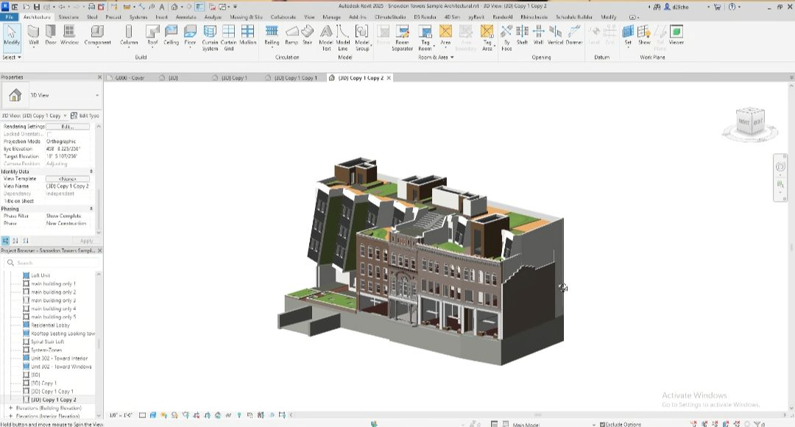
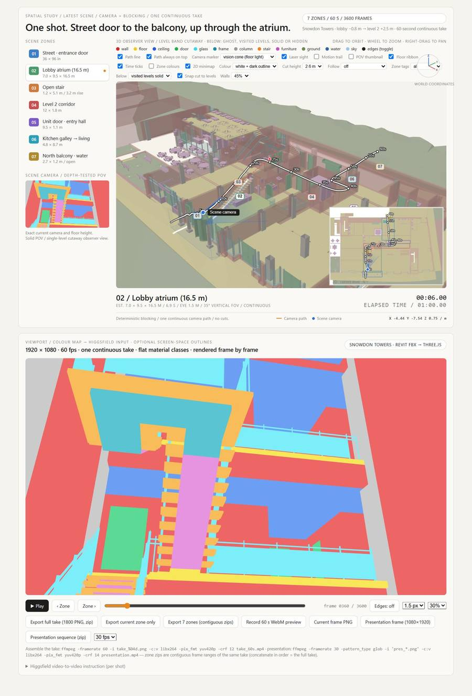
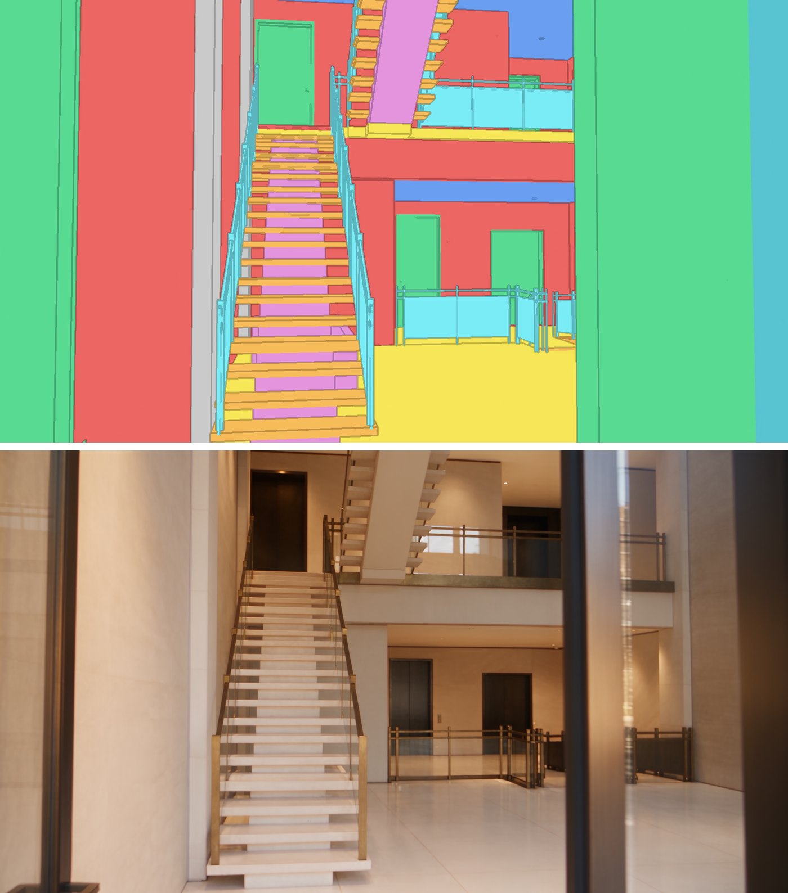
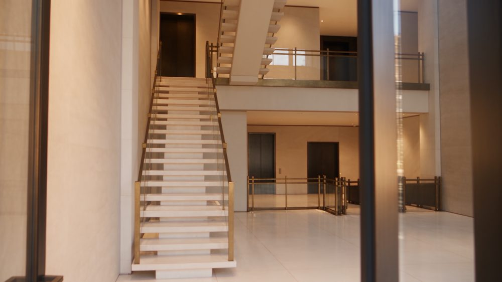
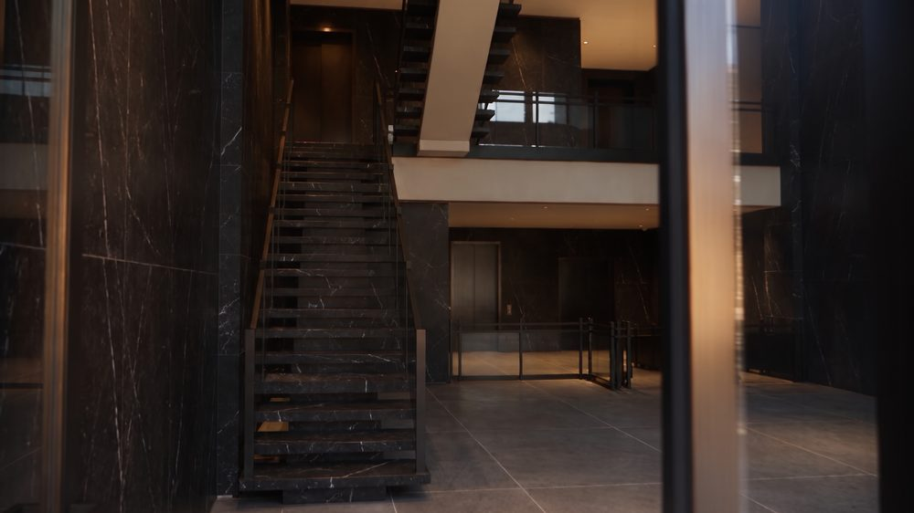
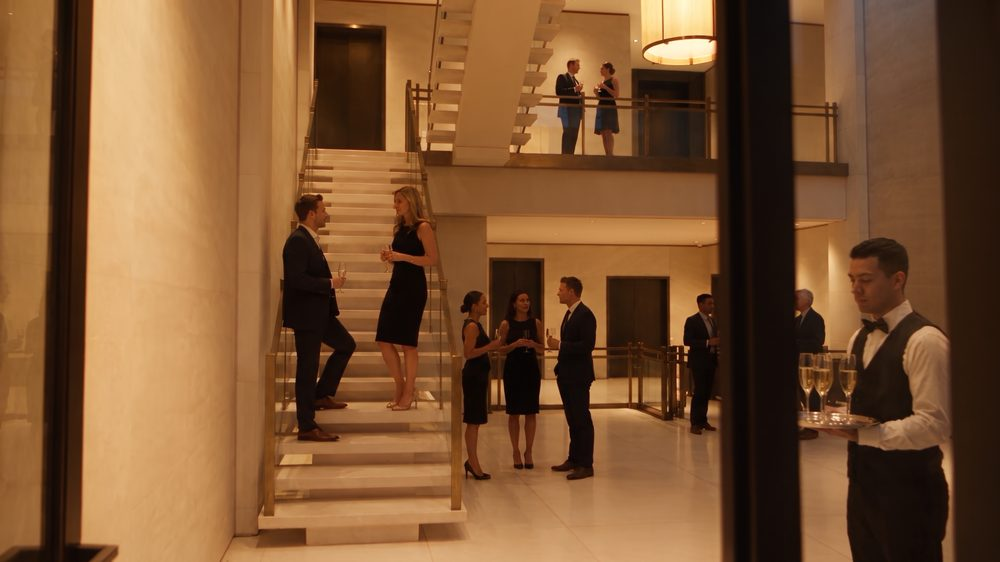
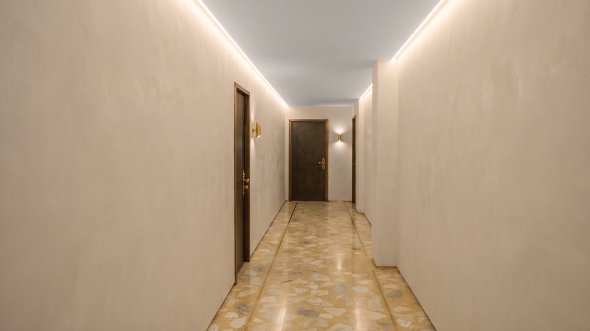

# A video walk through your own Revit model

Source: [archaiflow.com/research/revit-fbx-walkthrough](https://archaiflow.com/research/revit-fbx-walkthrough) (9 Sep 2026). Shown on Snowdon Towers in Revit 2025, with ChatGPT (Astra), the Higgsfield plugin, and Genjutsu for the video. Figures below are from that page.

Export a cropped Revit view as FBX, answer three questions, and the clip walks the path you picked. Doors, stairs, and railings stay where the model put them.

Needs [setup.md](../setup.md) only for the sample file. This article does not use the Revit MCP. It uses an FBX export plus Higgsfield.

## 1. Export the FBX

1. Open the 3D view you want to walk. A lobby and a stair are enough. A whole building is heavy to parse.
2. Crop it with a section box to that part.
3. Leave colour overrides and view templates off.
4. **File → Export → FBX**.



## 2. One prompt, three questions

In ChatGPT, on Astra, connect Higgsfield under Plugins. Attach the FBX and paste:

```text
My Revit FBX is attached. Work in this order and wait for my answer
before moving on.

0. Read the model. If it is too heavy, simplify it and tell me what
   you dropped.

1. Recommend 1 to 3 walkthrough routes. For each one: where it
   starts, where it ends, and why it works on camera. Draw them on
   the plan with timestamps. Ask me which one.

2. Analyze the chosen route and identify the space types it passes
   through from the model itself. For each type, show 3 to 4
   material and mood directions as images in this chat. Ask me to
   pick one per type.

3. Show 2 to 3 camera styles: eye height, speed, one take or cuts.
   Ask whether I want people, objects, both, or neither.

Then build one self-contained HTML file, no external files:
- a flat, unlit colour-map viewport of my model, one colour per
  material class: wall, floor, ceiling, door, glass, stair,
  column, furniture
- the chosen route as one continuous take, 60 seconds, eye height
  1.5 m, 1920 by 1080, with a scrub bar
- a timestamp for each zone and a legend of colour to class
- a button that exports the take as a PNG sequence

Then send the exported take to Higgsfield. Choose a mode that takes
the camera path from a video and the look from one reference image,
so the geometry cannot drift. In that prompt, say the colours are
material classes, not finishes, and name the material I picked for
each space type and each class.
```

You answer three times:

1. Which route. The reply draws the options on the plan with timestamps.
2. Which material and mood for each space type on that route.
3. Camera style, and whether the shot has people, objects, both, or neither.

The last paragraph is what keeps the flat colours from being read as paint. On the published run the mode was Genjutsu: camera path from the exported frames, look from one reference image.

To run the same prompt from Claude or Cursor, put the FBX in this folder, turn on the Higgsfield connector from [setup.md](../setup.md), and say the FBX path in the first line instead of “attached”.

## 3. The colour-map walk

The HTML file has two halves. The top half is the model, the route, and a camera you can scrub. The bottom half is the frame that gets exported: one flat colour per material class, one 60-second take at 1920×1080.



On this run the route is seven zones, street door to the north balcony, sixty seconds, one continuous take. Red is wall, yellow is floor, green is door, cyan is glass, orange is stair. The video model fills each region with the material you picked and leaves the geometry where it is.



Same take, four looks. The door, the stair, and the galleries stay put.









Check a door and a stair in the colour map against the finished frames before you send the clip. If those have moved, regenerate with the colour frames as the camera source and the material image as the look only.

Related stills method: [Revit Colour Maps for AI Renders](https://archaiflow.com/research/revit-consistent-renders).
