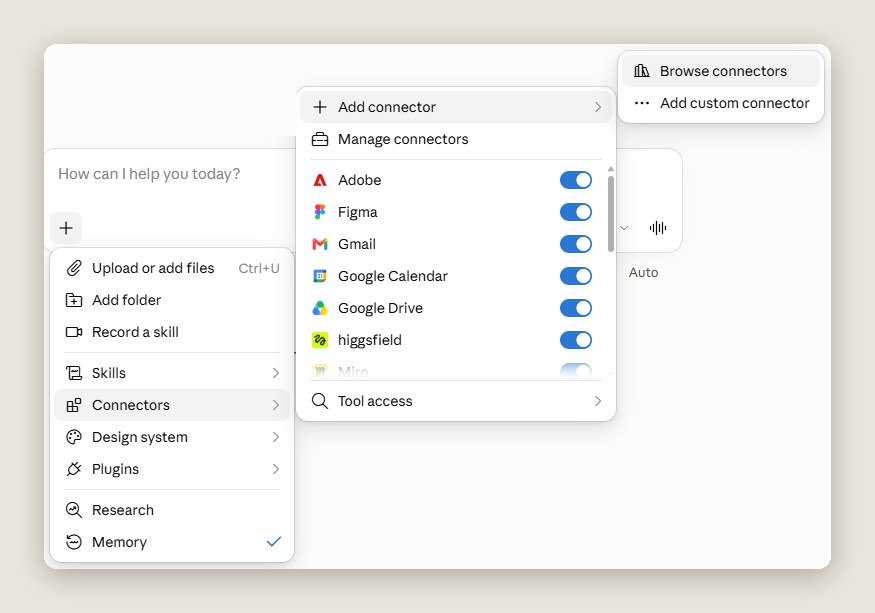
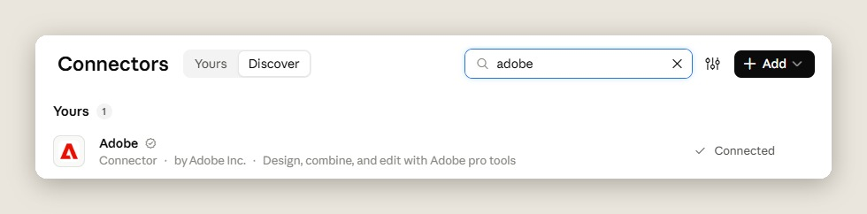
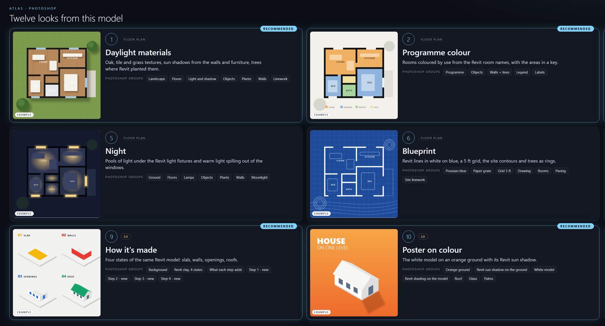
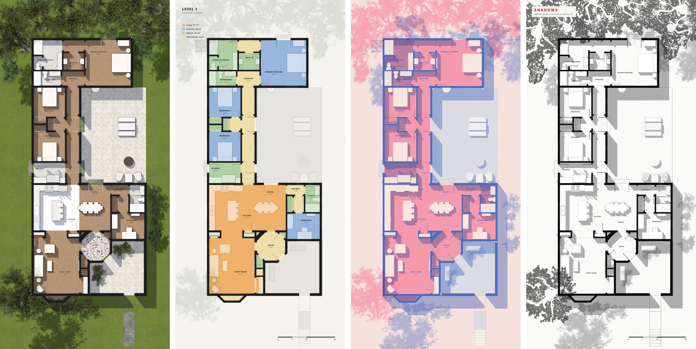
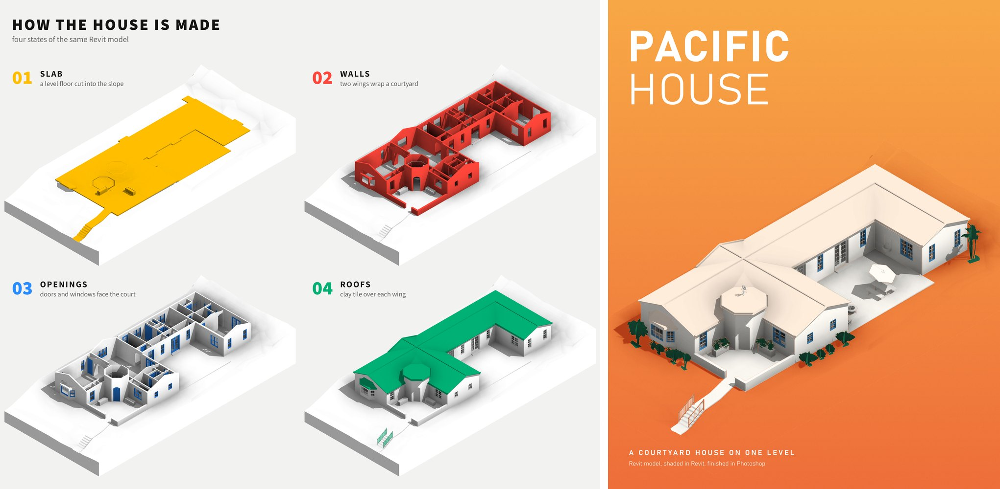

# Photoshop Looks, Six at Once

Source: [archaiflow.com/research/revit-photoshop-looks](https://archaiflow.com/research/revit-photoshop-looks) (20 Oct 2026). Shown on the Pacific Continental Residence in Revit 2027. Figures below are from that page.

Claude reads the Level 1 plan and the 3D views, shows twelve looks on one board, and marks six. You pick. Photoshop then builds the ones you chose side by side, one step at a time on each document. Every shape comes from a black-and-white mask exported from Revit, so a wall lands where the model has a wall in every look.

Finish [setup.md](../setup.md) first. Open Photoshop as well as Revit.

## 1. Connect Adobe

In Claude: **+ → Connectors → Add connector → Browse connectors**. Search **Adobe** and connect it. Switch on Revit and Adobe.





## 2. One prompt

Open the model in Revit and open Photoshop. Paste this into a new Claude chat:

```text
Use the Revit model I have open and Photoshop.

Read the Level 1 floor plan and the 3D views. Tell me what is
in them, with a count for each: walls, floors, rooms by use,
furniture, plants, glass and roofs.

Then ask me these one at a time, waiting each time:
1. which plan and which 3D view to use
2. which looks, on one board of numbered cards with made-up
   example pictures, marking the ones you would pick
3. how many to build at once, side by side in Photoshop

Work on copies of those views, so mine stay as they are.
Export each with a black and white mask for every kind of
thing in it, lined up pixel for pixel, to a folder in
Documents. Build every shape from those masks, one layer at a
time on each document in turns, with the room names last.
Save each one as a layered PSD and a PNG.

Never save the Revit model. Tell me what you made and where
the files are, and delete the view copies when I say I'm done.
```

Answer one question at a time. On the board, “do all six” means the ones Claude marked. After the last answer the rest runs.

The cards are invented examples, so you are picking a style, not a finished drawing. The published board marks six of twelve. Four of those six are on this half:



## 3. What comes back

One Photoshop session, a document per look, side by side. Each document gets one step, then the next document gets one step, so they grow together. Room names go on last. Each look is saved as a layered PSD with named groups, and as a PNG.





On the published computer, six looks took about 13 minutes. The plan and the 3D stay in agreement because both masks come from the same model.

When you are done, tell Claude to delete the view copies. The PSDs in Documents are yours to keep editing.
