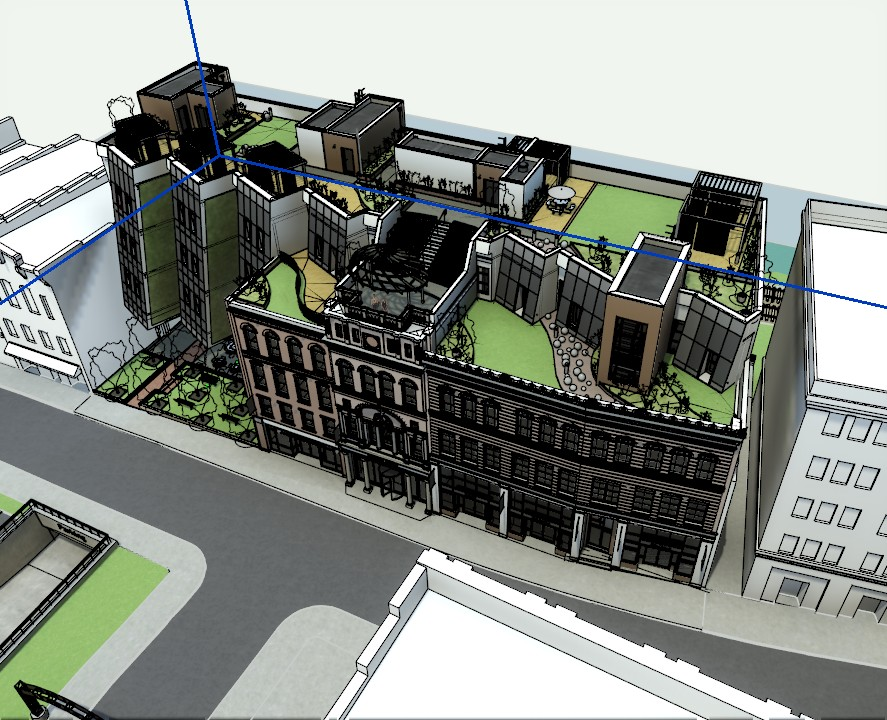
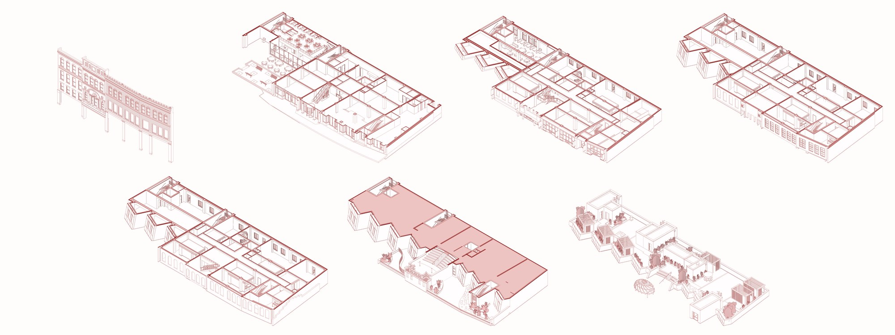
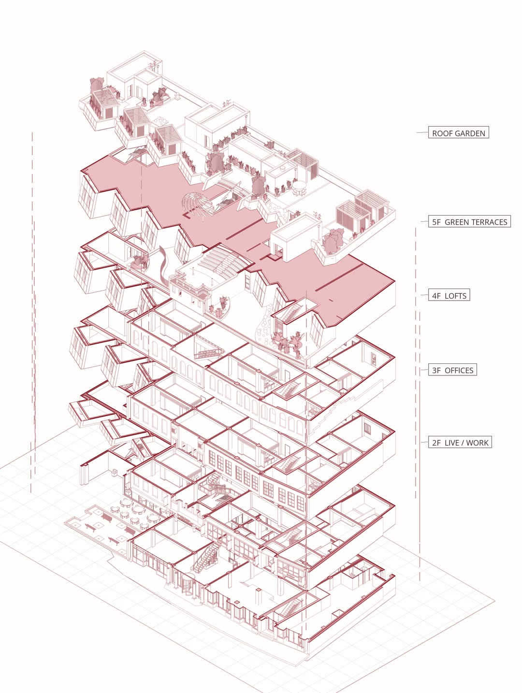
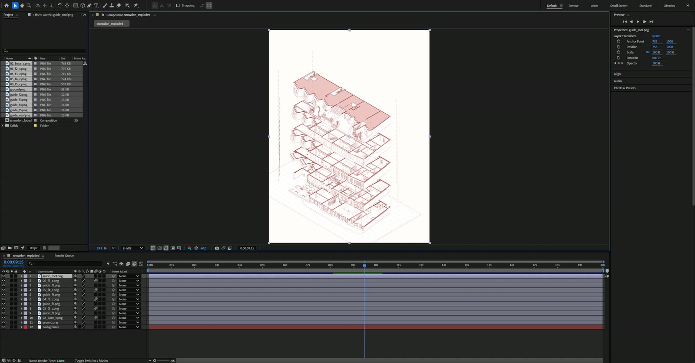

# Revit to After Effects

Source: [archaiflow.com/research/revit-after-effects](https://archaiflow.com/research/revit-after-effects) (30 Oct 2026). Shown on Snowdon Towers in Revit 2027, with After Effects 2026. Figures below are from that page.

Claude cuts one 3D view into pieces, a floor at a time, and builds an After Effects animation of the building coming apart and coming back together. You can watch the layers land, or render straight to a video.

After Effects has no MCP server. Claude writes a script and After Effects runs it. Use **Claude Code** (the Code tab in Claude Desktop, or the `claude` terminal), not a normal chat. Cursor can do the same job if the Revit connector from [setup.md](../setup.md) is on and After Effects is installed.

## 1. Connect Revit to Claude Code

pyRevit and the extension are already in [setup.md](../setup.md). This page adds the server to Claude Code. Paste into Claude Code:

```text
Connect the Revit MCP server to Claude Code on Windows.
The pyRevit extension is already installed at
%APPDATA%\pyRevit\Extensions\revit-mcp-python.extension

1. Install uv if it isn't already on PATH.
2. Add it with claude mcp add, as "revit", running the main.py
   in that folder with uv. Use the same command the repo README
   gives in its "Connecting to Claude Desktop" section:
   https://github.com/revit-mcp/revit-mcp-python
3. Tell me when it's done, and remind me to restart Claude Code.
```

The command in that README is:

```powershell
claude mcp add -s user "Revit-Connector" -- uv run --frozen mcp run C:\Users\USER\AppData\Roaming\pyRevit\Extensions\revit-mcp-python.extension\main.py
```

Change the path if `main.py` is in a subfolder. Restart Claude Code. In Revit, **MCP → Bridge → Connect**, with the model open.

## 2. Let After Effects save files

In After Effects open **Edit → Preferences → Scripting & Expressions** and turn on **Allow Scripts to Write Files and Access Network**. Without it, a script that writes a file stops on a warning.

The prompt tells Claude to call `AfterFX.exe -r` and `aerender`. Both sit in the Support Files folder next to the After Effects app, for example `C:\Program Files\Adobe\Adobe After Effects 2026\Support Files`. Keep Revit open.

## 3. One prompt

Paste this into Claude Code:

```text
Use the Revit model I have open and After Effects.

Read the model's levels, rooms, phases and 3D views. Tell
me what you found, with a count for each.

Then ask me these one at a time, waiting each time:
1. which 3D view to start from, or a new isometric one
2. how to cut the building into pieces, 2-3 options from
   what you found
3. how the pieces should move, 2-3 options on one board of
   numbered cards with made-up example pictures, marking
   the one you would pick
4. render it straight to a video, or build it in After
   Effects on screen, one layer at a time, so I can watch

Work on a copy of the 3D view, so the model's own views
stay as they are. Export every piece from that one view
with the same crop, so they line up. Then build the After
Effects project: one layer per piece, labels named from
the rooms on each level, and the moves I picked. Save the
project and render an MP4 next to it.

While you work:
- Revit has no see-through export. Export each piece
  twice, on a white and on a black background, and work
  out the see-through part from the difference.
- Cut floors with a section box per level, so a wall that
  runs through several floors is cut with them.
- A new 3D view starts with shadows on. Turn them off.
- Send After Effects your scripts with AfterFX.exe -r and
  render with aerender, both in its Support Files folder.

Never save the Revit model. Tell me where the files are,
and delete the copy of the view when I say I'm done.
```

Answer one question at a time. After the last answer the rest runs. The four lines under “While you work” are what make the pieces line up: white/black pair for transparency, one section box per level, shadows off, and the two Adobe executables.

## 4. What comes back

On Snowdon the read-back was 67 rooms on nine levels, plus an old brick facade kept in its own phase.



The published cut was seven pieces: the old facade (289 elements as one piece), ground floor, levels 2 to 5, and the roof. Each floor is its own section box, from the same camera crop.



The animation drops the pieces in, lifts the roof, sweeps a section line, slides the old facade out along the street, and raises the floors with labels. Then it goes back together. Trees, clouds, dashed guides, and labels are drawn by the script. The building is the export. The moves follow Toffu Co’s exploded-building tutorial. The published video is 20 seconds.



Pick the on-screen build and After Effects opens in front of you. Layers arrive, the timeline fills, and the preview plays. The published project is 22 layers. The page shows that build at three times speed.



When you are done, tell Claude to delete the copied 3D view. Close Revit without saving if anything else changed.
