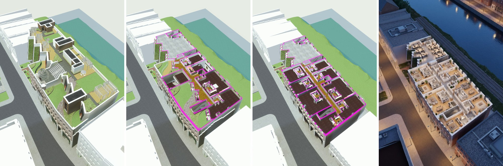
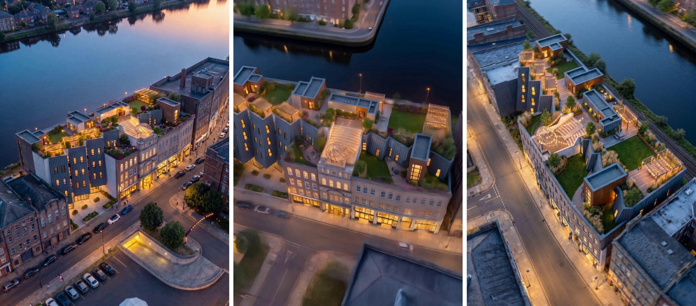
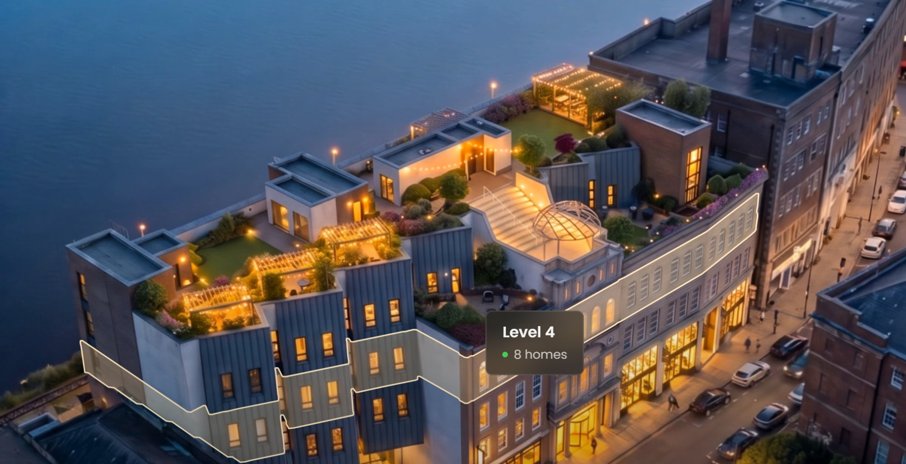
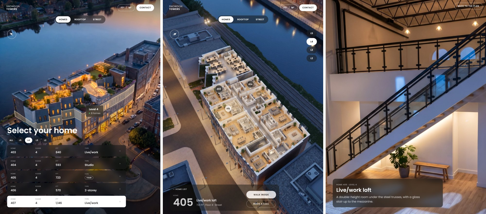
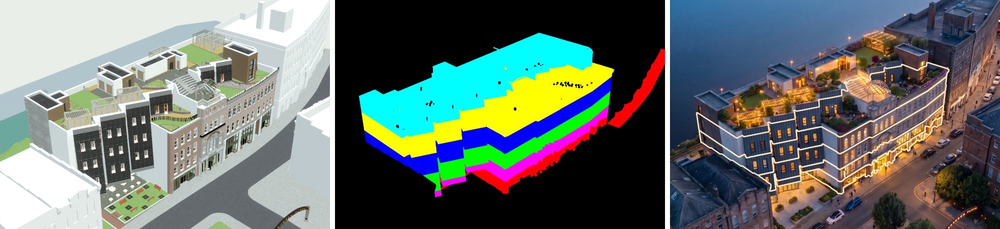

# Revit to Home Tour

Source: [archaiflow.com/research/revit-home-tour](https://archaiflow.com/research/revit-home-tour) (10 Nov 2026). Shown on Snowdon Towers in Revit 2027, with Claude Code, the Revit MCP, and Higgsfield. Figures below are from that page.

Claude picks the views that sell the building, makes a section cut inside Revit, and offers a few website looks. You pick one. Higgsfield turns those views into photos and short clips. The sales page is built around them: an aerial where each floor lights up, the homes on that floor, the section cut, the rooftop, and the street. Every number comes from the model.

Finish [setup.md](../setup.md) first. Switch on Revit Connector and Higgsfield. Open Snowdon Towers, or your own model, in Revit. Paste the prompt into Claude Code. With both connectors on, the same prompt works in Claude Desktop.

This is the dusk sales site. The project page of rooms, areas, and wall build-ups is [Revit to Website](../revit-to-website/guide.md).

## 1. Connect Higgsfield

In Claude Desktop: **Settings → Connectors → Add custom connector**. Name it `Higgsfield`. Paste `https://mcp.higgsfield.ai/mcp`. Click **Connect** and sign in.

A connector added there also shows up in Claude Code when you sign in with the same account. In the chat, open **+ → Connectors** and switch on Revit and Higgsfield. Stills and clips spend Higgsfield credits. Claude shows the cost before each one.

When a step needs a picture from your computer, Claude saves the Revit view and opens an upload window. Drop that file in, then say it is uploaded. Higgsfield does not open the file on its own.

## 2. One prompt

Open the model in Revit, then paste:

```text
Use the Revit model I have open.

Read it first: the levels, the homes on each level with
number, type and area, and every 3D camera view. Tell me
what you found, with a count for each.

Then ask me these one at a time, waiting each time:
1. which views sell the building best, 2-3 options from
   the cameras you found
2. which look for the website, 2-3 options shown as
   picture cards

Work on copies, so the original stays as it is. Make a
section cut video from the aerial view that moves down
one floor at a time, from the roof to the lowest floor
with homes.

Turn the picked views and the cuts into photos and short
videos with Higgsfield. Keep the camera and the building
exactly as they are in the model.

Build one sales page in the look I picked: the aerial
photo where each floor lights up when you point at it,
the homes on each floor with their plans, the section
cut, the rooftop and the street. Every number comes from
the model. Make it an artifact I can share with a link.

Never save the Revit model. Tell me what you did and how
to undo it.
```

Claude stops twice: once for the views, once for the look. After the second answer the rest runs. The section cut is made on a copy of the aerial view. Delete that copy when you are done.

## 3. What comes back

First, the section cut in Revit, moving down one floor at a time. On the page it ends on that floor’s plan.



After you pick a look, Higgsfield turns the views and the cuts into photos and short videos. The camera and the building stay where they are.



The page is built around the aerial. Point at a floor and it lights up, with the number of homes on it. Click it to open the homes on that floor.



Each floor lists its homes with number, floor, area, and type, all read from the model. Pick one and the building cuts down to that floor’s plan, with a pin on every home. One home opens to a photo of the inside. Between the photo and the plan, the cuts play from the roof down to the floor you picked. The top bar switches areas between square feet and square metres.



## 4. Why the outlines fit the photo

The views, the cut, and every home number and area come from the Revit model. Higgsfield is asked to change only the light, materials, planting, and people.

The outline you hover is traced, not drawn by hand. Claude renders a second picture from the same aerial camera, with each floor in one flat colour by its height, then traces each colour and lays it on the photo. Trees are hidden in that colour copy, so nothing in front covers the ground floor.



The photo step keeps the camera and every window where they are, so the outlines still fit. Check that each outline sits on its floor before you send the page. A drifted window puts the hover on the wrong floor.

## 5. Send it

The page comes back as an artifact. Share it from the Share menu, or download it. Anyone with the link can open it. Check with the client first when the homes are not on sale yet.

The model is never saved. The section cut lives on a copied view. When Claude tells you what it made, delete that copy. Close Revit without saving if anything else changed.
