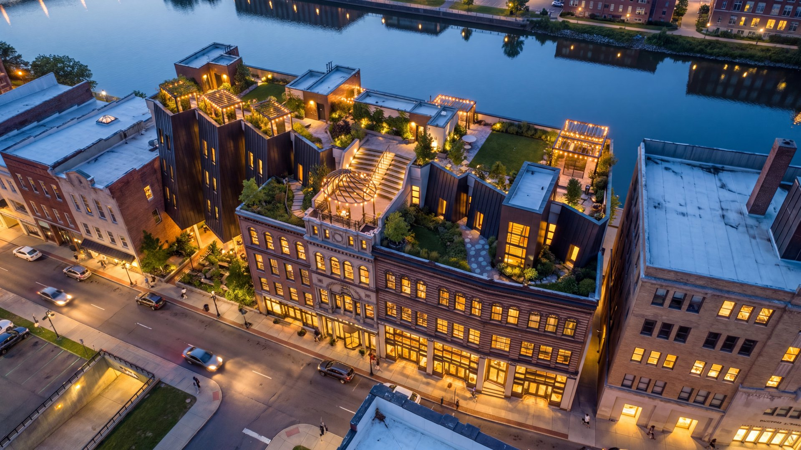

# Skrót

13 listopada, od 16:42, z otwartego modelu Snowdon Towers powstała strona sprzedaży. Pierwsza wersja była gotowa około 17:21. O 17:28 obrys pięter został odrzucony, bo nie leżał na budynku. Po doładowaniu obrazów tego samego wieczoru powstała druga wersja, w osobnym folderze, i około 20:53 weszła na GitHub Pages.

Fable 5.2 to model z artykułu, który był wzorem. Nie mam jego sesji i nie on wybierał kadry tej strony. Wybór jest w tym wątku: agent zaproponował trzy zestawy kamer, Ty odpisałeś **A** (z góry, ulica, dach, loft 405), potem **A** (wygląd zmierzchu), potem „weź najlepszą ofertę” przy 10 kredytach.

Budynek wie, gdzie jest, bo każdy widok 3D w Revicie ma oko, kierunki i prostokąt kadru, a każde pomieszczenie ma punkt w stopach. Skrypt `proj.py` rzutuje ten punkt na kadr tej kamery i dostaje procent szerokości i wysokości. Strona rysuje pinezkę w tym procencie. To nie jest GPS i nie jest zgadywanie. Jak obraz przesunie kadr, pinezka już nie pasuje. Dlatego odpadł model filmu, który przekadrowywał scenę.

Model nie został zapisany. Cofnięcie: zamknąć Revita bez zapisu albo skasować widoki o nazwie zaczynającej się od `HT`.

Strona: [eska5.github.io/Claude_higgsfield_revit_wizualizacje](https://eska5.github.io/Claude_higgsfield_revit_wizualizacje/).
