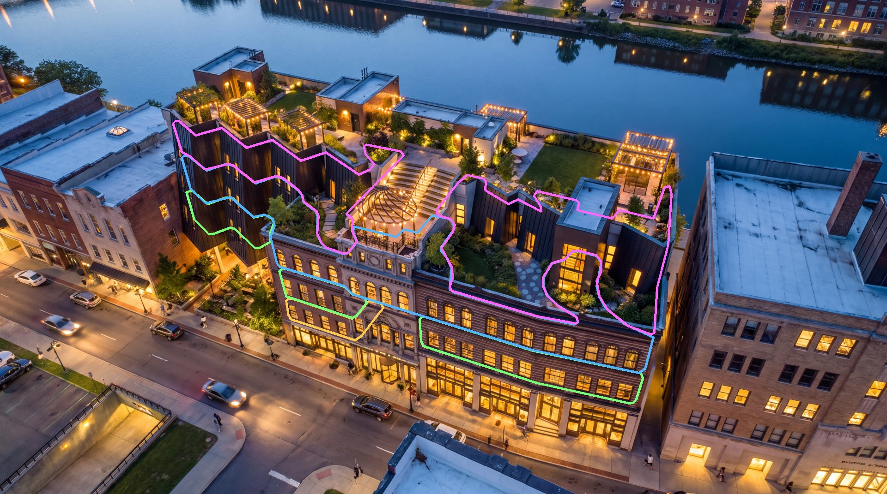
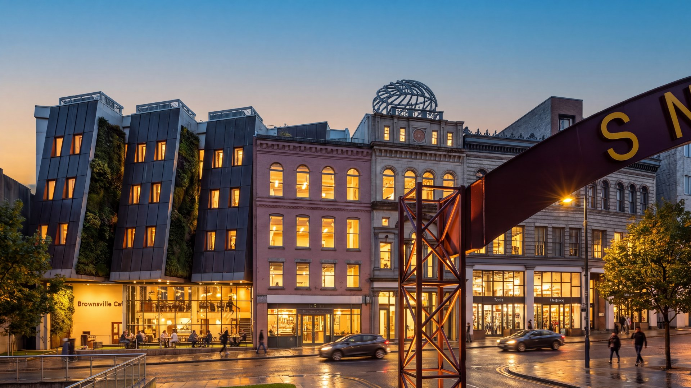
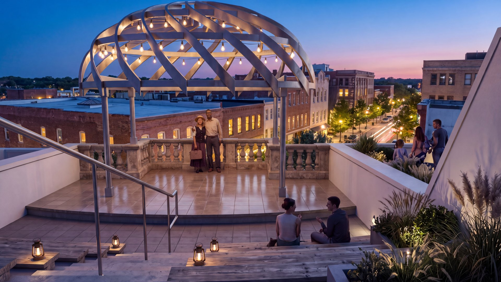
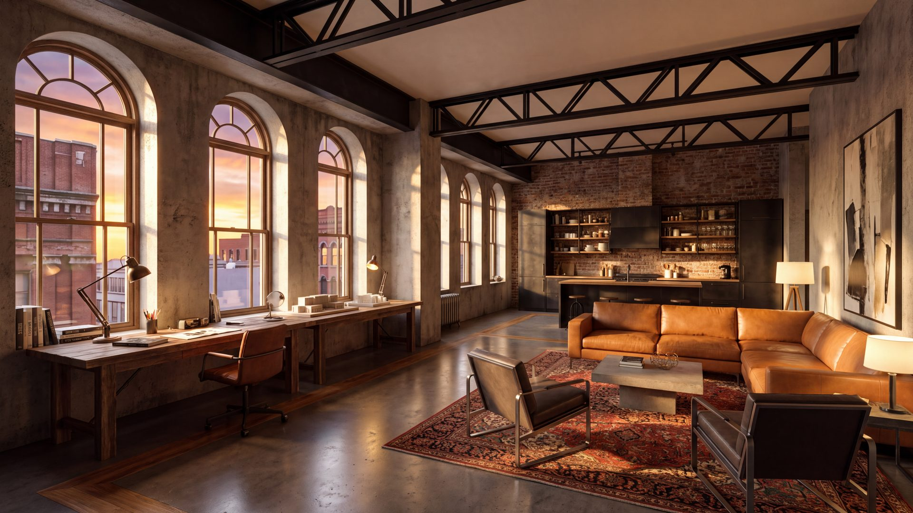

# Przebieg, decyzja po decyzji

Źródło to zapis tego czatu, 356 zdarzeń, od 13 listopada 14:41. Nie jest to sesja Fable 5.2. Tę nazwę widać tylko przy szukaniu artykułu-wzoru.

## Do 16:42: instrukcja, nie strona

Od 14:41 powstały przewodniki pod artykuły Archaiflow, folder `revit-to-home-tour` i notatki: który plik otworzyć (Revit 2027, Architectural, jako model `.rvt`, nie jako rodzinę), co zrobić z brakującymi odniesieniami, jak w ogóle ruszyć Revita. Potem połączenie z Revitem przez pyRevit. Samo czytanie modelu raz utknęło na oknie „Revit MCP request review”.

## 16:42–16:53: odczyt i dwa wybory

Prompt kazał najpierw przeczytać model i pytać po jednym.

O 16:52 odczyt dał: 18 poziomów, 21 mieszkań na L2–L5, 50 widoków 3D, 366 widoków w ogóle. Widoki `HT - Aerial`, `HT - Street`, `HT - Rooftop`, `HT - Loft 405` i cięcia `HT - Cut L2`–`L5` już wtedy były w pliku. W wątku nie ma kroku, w którym Fable je wybiera. Agent ułożył z nich trzy pakiety:

- **A, zestaw spaceru:** z góry, ulica, dach, loft 405. Rekomendowany, bo pokazuje cały budynek i jedno wnętrze.
- **B, róg od rzeki:** ta sama wysokość, ale kamera na rzekę.
- **C, życie ulicy:** parter, hol, taras, lokal 302. Mało całego budynku.

O 16:52 przyszło **A**. O 16:53, po kartach wyglądu, drugie **A**: zmierzch, ciemne tło, złote światło. Cięcia miały iść z kopii widoków. Model bez zapisu.

## 17:01: 10 kredytów i „najlepsza oferta”

Pełny zestaw zdjęć i filmów nie mieścił się w 10 kredytach. Trzy plany:

- **A:** cztery zdjęcia zmierzchu, cięcia zostają eksportem z Revita. 4 kredyty.
- **B:** jedno lepsze zdjęcie z góry i jedna pętla. 9,5 kredytu. Reszta zostaje surowa.
- **C:** zero kredytów, strona tylko z eksportów.

„Pick the best deal” zostało rozegrane taniej niż A z cennika: cztery zdjęcia modelem GPT Image 2, około 0,5 kredytu sztuka. Wydane 2, zostało 8. Cięcia na stronie to PNG z Revita, bez filmu. Strona otwarta około 17:21 w `run/sales-page/`.

## 17:21–17:28: dobicie kredytów i ocena obrysu

O 17:21 prośba, żeby dobić do filmu-wzoru i wydać resztę. Wydane ostatnie 8: ostrzejsze zdjęcie z góry, cięcia L5–L2 po zmierzchu, 3-sekundowy klip z góry na dach. Saldo 0.

O 17:28 ocena: na wzorze są jadące samochody i przejścia, a obrys budynku jest nie do przyjęcia.

Przyczyna, spisana przy commicie o 17:47, bo wcześniejsza wiadomość ją złagodziła:

1. Wielokąty były grubym obrysem ze słabej maski kolorów, nie płytą stropu.
2. Obraz przyciął kadr do 16:9, więc ślad z Revita przestał się zgadzać.
3. Strona rozciągała obraz przez `object-fit: cover`, więc nawet dobry procent siadał obok.
4. Pinezki mieszkań były procentami wymyślonymi na oko. Opis loftu 405 był przepisany z artykułu, nie z modelu. „Wejdź” dla lokalu innego niż 405 pokazywało cięcie piętra, nie wnętrze.

Automatyczne śledzenie koloru (`trace_floors.py`, `trace_floors2.py`) odpadło. Pasma głębokości malowały ściany złym piętrem. Zostały wielokąty wpisane ręcznie. Przy commicie jest wprost: te obrysy nie są z modelu i dalej nie leżą na budynku. Samochodów w 3-sekundowym klipie nikt wtedy nie sprawdził. Filmu-wzoru nie dało się otworzyć na tej maszynie.

Commit `5063cdf`. Surowe maski, około 255 MB, nie weszły do gita.

## Wieczór: druga wersja, już z geometrii

Po doładowaniu druga strona powstała obok, w `run/sales-page-v2/`. Pierwsza nie była ruszana, żeby dało się je porównać.

Nowe kamery `HT2` są kopiami. Z każdej spisano oko, osie i kadr (`cams_ht2.json`). Z pomieszczeń numer, metraż, poziom i punkt (`rooms.json`). Dwie kamery wnętrza na lokal wybrał `pick_room_cams.py` z promieni widoczności, nie z gustu.

`proj.py` rzutuje punkt pomieszczenia przez kamerę. Dlatego pinezka wie, gdzie jest lokal: to ten sam punkt, który w Revicie ma pomieszczenie, widziany tą kamerą. `build_overlays.py` robi to dla całych obrysów, z zasłanianiem jak w widoku. Wyższe piętro zakrywa niższe, taras zostaje na swoim stropie, ogród na dachu jest nakrywką.

Na ulicy pierwsza odległość kadru była zła. U tej kamery prostokąt leży 0,1 stopy przed okiem, nie na dalszej ściance crop boxa. Po wstawieniu 0,1 podpisy kawiarni, sklepów, parku i holu spadły na parter.

## Dlaczego ten film, a nie droższy

Porównane zostały dwie generacje z tego samego kadru. Kling 4.0 zostawia pierwszą klatkę (skala około 0,997, kilka pikseli na 10 s). Seedance 2.5 przesunął scenę o kilkadziesiąt pikseli. Seedance odpadł, bo obrys jest przyklejony do pikseli. Mierzył to `align_check.py`.

Dach: kamera `HT2 - Rooftop` patrzy w ulicę. Pierwszy opis i tak prosił o rzekę, więc obraz domalował wodę za altaną. Zdjęcie i dwa filmy zrobiono drugi raz, z miastem. Stare pliki zostały jako `*-old` i strona ich nie używa.

Wnętrza: 42 eksporty, po dwa na lokal. Meble są dopowiedziane. Wlot wchodzi na dobre piętro, nie da się pokazać, że w dokładnie ten numer.

Pory dnia to pięć zdjęć z tej samej kamery plus film poklatkowy 12 s. Suwak szuka w tym filmie klatki najbliższej zdjęciu: świt 0 s, południe 2,6 s, złota godzina 9 s, zmierzch 10 s, noc 12 s.

## Strona i publikacja

`build_site_data.py` składa `data.js` z pomieszczeń i z rzutowania. `build_site_assets.py` zmniejsza obrazy i skleja pętle oraz cofnięcia filmów przez ffmpeg. `serve.py` dodaje pobieranie zakresami, bez którego przeglądarka nie przewija filmu poklatkowego.

Około 20:36 pierwsza publikacja padła, bo Pages nie było włączone. Około 20:53 druga przeszła. Adres: [eska5.github.io/Claude_higgsfield_revit_wizualizacje](https://eska5.github.io/Claude_higgsfield_revit_wizualizacje/).

Na obrazy drugiej wersji poszło około 1900 kredytów z 3000. To suma zleceń, nie wyciąg z konta.
