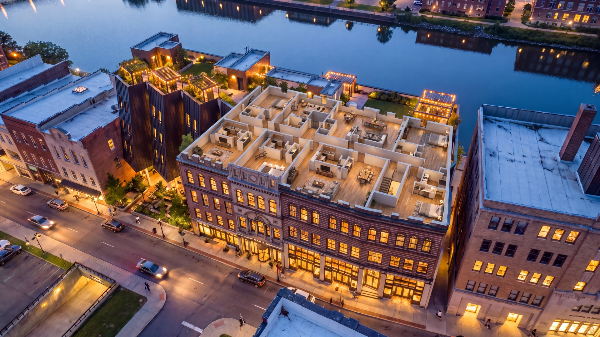
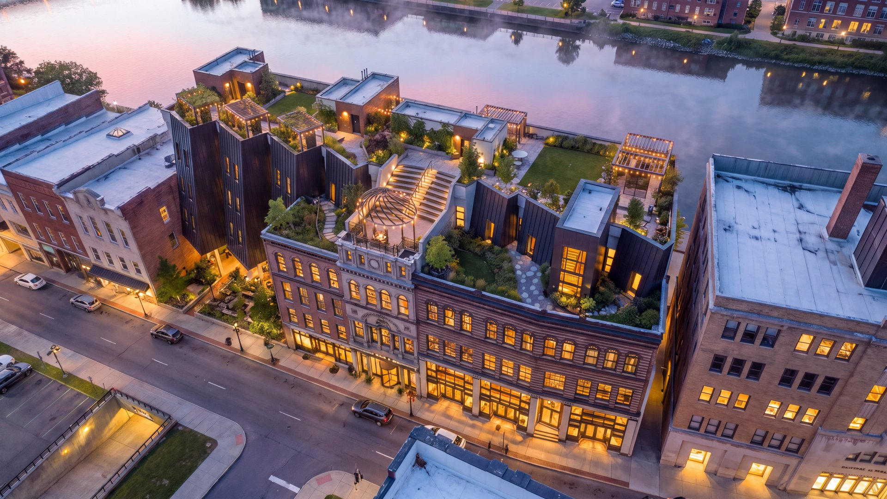

# Szczegóły: skrypty, decyzje, skąd strona wie, gdzie jest budynek

Zapis tego czatu ma 356 zdarzeń, od 13 listopada 2026, 14:41, do publikacji wieczorem i tych podsumowań następnego dnia. To jest jedyny wątek, do którego mam dostęp. Nie mam sesji Fable 5.2.

## Kim jest Fable w tym projekcie

Artykuł-wzorzec, [Revit to Home Tour](https://archaiflow.com/research/revit-home-tour), jest opisany jako robota Claude’a z Revitem i Higgsfield. Na początku tego czatu padło wyszukiwanie „Fable 5.2 Revit Higgsfield”, bo tak nazywa się ten model Claude’a w ofercie. Z artykułu dało się wziąć prompt, kolejność kroków i zdjęcia. Nie dało się wziąć jego wewnętrznych decyzji: które piksele uznał za piętro i jakich kadrów szukał po drodze.

W tym wątku kadry wybrał agent czatu, a zatwierdziłeś je Ty:

| Godzina | Kto | Decyzja | Dlaczego tak |
| --- | --- | --- | --- |
| 16:52 | agent zaproponował, Ty: **A** | Z góry, ulica, dach, loft 405 | Pakiet B chowa ulicę, pakiet C nie pokazuje całego budynku |
| 16:53 | Ty: **A** | Wygląd zmierzchu | Karty wyglądu, ciemne tło, ciepłe światło |
| 17:01 | Ty: najlepsza oferta | 4 zdjęcia GPT Image 2 za około 2 kredyty, nie 4 | Zostało 8 kredytów na dobicie cięć i jednego klipu |
| 17:28 | Ty | Obrys v1 odrzucony | Nie leżał na bryle, brak samochodów i przejść |
| wieczór | agent, po doładowaniu | Osobny folder v2, Kling zamiast Seedance, dach bez rzeki | Żeby v1 została do porównania, a obrys nie rozjechał się z filmem |

Widoki `HT - …` o 16:52 już były w otwartym pliku. Wątek nie zawiera kroku „Fable wstawił te kamery”. Agent wziął je z listy 50 widoków 3D, bo nazwy pokrywały się z artykułem.

## Dlaczego budynek wie, gdzie stoi na zdjęciu

To nie jest rozpoznawanie obrazu i nie jest współrzędna geograficzna.

Revit trzyma perspektywę tak:

- oko kamery, punkt w stopach modelu,
- trzy osie: w prawo, w górę, do przodu,
- prostokąt kadru leżący na płaszczyźnie przed okiem.

Pomieszczenie ma własny punkt, też w stopach, plus numer, nazwę, poziom i metraż. `proj.py` odejmuje oko od punktu, rozkłada różnicę na osie kamery i przez podobieństwo trójkątów kładzie punkt na prostokąt kadru. Wynik to ułamek szerokości i wysokości, od lewego górnego rogu.

Strona trzyma zdjęcie i rysunek w jednym prostokącie 16:9. Procent z `proj.py` jest procentem na ekranie. Pinezka mieszkania 407 leży tam, gdzie kamera `HT2` widzi punkt pomieszczenia 407. Obrys piętra jest z wielu takich punktów, z krawędzi bryły, nie z jednego.

To się sypie w trzech sytuacjach i wszystkie trzy zdarzyły się w wersji pierwszej:

1. Obraz przekadrował eksport. Procenty zostały policzone do starego kadru.
2. Strona przycięła obraz przez `object-fit: cover`. Prostokąt na ekranie przestał być prostokątem kadru.
3. Wielokąt był narysowany ręcznie, bo śledzenie koloru nie dało płyty stropu.

Dlatego druga wersja najpierw mierzy, czy film rusza kadr (`align_check.py`), a dopiero potem idzie na stronę. I dlatego zdjęcia pór dnia są z jednej kamery: jeden zestaw procentów pasuje do świtu i do nocy.

Wyjątek, który wyszedł przy ulicy. Dla kamery `HT2 - Street` prostokąt kadru leży 0,1 stopy przed okiem. Dalsza ścianka crop boxa dawała złą odległość i punkty wypadały poza obraz. `build_site_data.py` wstawia 0,1 tylko dla hotspotów ulicy i dachu. Po tym kawiarnia, sklepy, park i hol siadły na parterze. Ich metraż jest z pomieszczenia. Nazwa na szyldzie nie jest.

„Strona rzeki” i „strona ulicy” to już zgadywanie. Nie ma takiego parametru. `pick_room_cams.py` bierze znak współrzędnej punktu względem budynku. Na stronie jest o tym zdanie.

## Oś czasu

- **14:41–16:40.** Przewodniki, wybór pliku (`which-file.md`: Architectural, Revit 2027, otwierać jako model), brakujące odniesienia, pierwsze połączenie z Revitem. Okno zatwierdzenia kodu zablokowało jeden odczyt.
- **16:42.** Prompt: przeczytaj, pytaj po jednym, pracuj na kopiach, nie zapisuj, liczby z modelu.
- **16:52.** 18 poziomów, 21 mieszkań, 50 kamer. Pytanie o zestaw widoków.
- **16:52–16:53.** A, potem A.
- **17:01.** Cennik przy saldzie 10. Pełny zestaw się nie mieści.
- **17:21.** Strona v1. Wydane około 2 kredyty na cztery zdjęcia, cięcia z PNG.
- **17:21–17:28.** Ostatnie 8 kredytów: lepsze zdjęcie, cięcia, klip 3 s. Saldo 0.
- **17:28.** Obrys odrzucony.
- **17:47.** Commit `5063cdf`. W wiadomości wprost: obrysy są ręczne i dalej złe, samochodów nie sprawdzono, filmu-wzoru nie otwarto.
- **Wieczór.** v2 w `run/sales-page-v2/`. Rzut przez kamerę, filmy, 42 wnętrza, suwak pory dnia.
- **20:36.** Publikacja pada: Pages nie włączone.
- **20:53.** Publikacja przechodzi.

Od promptu o 16:42 do pierwszej strony minęło około 40 minut. Do commita v1 około godziny. Druga wersja doszła tego samego wieczoru, po doładowaniu. W wątku nie ma jednego zdania „start v2 o tej godzinie”, więc nie zapisuję tego jako równo trzy godziny.

## Skrypty wersji pierwszej

Zostały. Część to ślepe uliczki i przy commicie tak je opisano.

| Plik | Po co | Dlaczego tak skończył |
| --- | --- | --- |
| `run/export_previews.py` | Eksport nazwanych widoków do PNG przez lokalny mostek | Został, bo jest mały i powtarzalny |
| `run/model-read.md` | Zapis tego, co odczytano z modelu | Żeby liczby na stronie dało się sprawdzić |
| `run/choices.md` | Zapis wyborów A i A | Zostawiony ze starym „zostało 8 kredytów”. Przy commicie świadomie nie poprawiany, bo diff był już obejrzany. Faktycznie saldo zeszło do 0 |
| `sales-page/trace_floors.py` | Maska koloru i największy kontur | Odporny na światło i drzewa. Obrys puchł |
| `sales-page/trace_floors2.py` | Druga próba maski, diagnostyka kolorów | To samo. Nie wszedł do commita |
| `sales-page/build_outlines.py` | Wielokąty „dopasowane” do zdjęcia zmierzchu | Współrzędne wpisane po tym, jak maski padły. Komentarz w pliku mówi wprost: dopasowane do `dusk-aerial.png`, tylko główna bryła |
| `sales-page/floor-hulls.json` | Te ręczne wielokąty | To, co strona v1 rysuje. Nie z geometrii |
| `sales-page/index.html` | Strona v1 | Zostawiona celowo, jako „przed” |

Widoki dokładane przy v1, też bez zapisu modelu: `HT - Color Mask`, `HT - Color Mask 2`, `HT - Slab Mask L2`–`L5`, `HT - Slice L2`–`L5`, oraz wcześniejsze HT: Aerial, Street, Rooftop, Loft 405, Cut L5–L2. Przy Aerial włączono crop box. Pomysł z maską koloru: jedno piętro jednym kolorem, potem ślad konturu. Ściany dostały zły kolor przez pasma głębokości, więc powstały cięcia per piętro (`Slice`). I to nie wystarczyło, gdy obraz zmienił kadr.

## Skrypty wersji drugiej

Wszystkie w `run/v2-work/`, chyba że napisano inaczej. Uruchamia się je z tego folderu.

| Plik | Co robi | Dlaczego powstał |
| --- | --- | --- |
| `proj.py` | Rzut punktu modelu na kadr 0–1. Funkcja `homes()` wybiera lokale mieszkalne i wyrzuca numer 106 | 106 to hol, nie mieszkanie. Jeden wzór dla pinezek, obrysów i hotspotów |
| `build_overlays.py` | Bufor głębokości: dla piksela zostaje ściana najbliższa kamerze. Taras na swoim poziomie, ogród na dachu jako nakrywka. Zapis `overlays.json` w procentach | Malowanie od góry zostawiało kawałek L3 na dachu i prześwit L4 |
| `check_overlay.py` | Rysuje wielokąty na zdjęciu | Żeby ocenić linijką, nie z pamięci |
| `check_proj.py` | Rzut próbny kamer HT na pomieszczenia | Szybki test, zanim policzy się cały obrys |
| `cams_ht.json`, `cams_ht2.json` | Oko, osie, kadr widoków | Bez tego `proj.py` nie ma czego liczyć |
| `rooms.json` | Pomieszczenia: numer, nazwa, occupancy, poziom, metraż, punkt | Jedno źródło liczb. Plik jest duży, bo są też pomieszczenia niemieszkalne |
| `rays_L2.json` … `rays_L5.json` | Promienie widoczności wewnątrz lokali | Surowiec do wyboru kamer, nie do strony |
| `pick_room_cams.py` | Dwa punkty kamery na lokal, z tych promieni. Zapis `room_cams.json`, w tym pole `side` | Ręczne ustawianie 42 kamer powtórzyłoby błąd dachu: opis bez kierunku |
| `ref_frames.py`, `ref_site.py` | Klatki odniesienia do porównania kadru | Zanim wyda się kredyty na film |
| `align_check.py` | Skleja kadr filmu ze zdjęciem wzorcowym i mierzy skalę oraz przesunięcie | Tym odpadł Seedance |
| `vid_check.py` | Klatki filmu i wycinek ulicy, czy samochody w ogóle są | Bo przy v1 „są samochody” powiedziano bez sprawdzenia |
| `hf_upload.py` | Wysyła PNG do slotów i zapisuje `media_ids.json` oraz `slots_used.json` | Higgsfield nie czyta dysku sam |
| `hf_get.py` | Ściąga wynik i robi mały podgląd w `hf/_p/` | Kontaktówka zamiast oglądania 42 filmów po kolei |
| `dl.py` | Ściąga po skrócie `HHMMSS:id` z `jobs.json` | Adres jest składany ze znacznika czasu z odpowiedzi. Plik ma identyfikator konta, dlatego nie wszedł do gita |
| `jobs.json` | Nazwa ujęcia → identyfikator zlecenia | Żeby dało się dociągnąć wynik po czasie. Też poza gitem |
| `sheet.py`, `sheet_previews.py`, `preview.py` | Kontaktówki JPG | Ocena serii na jednym obrazku |
| `build_site_data.py` | Pisze `sales-page-v2/data.js`: lokale, obrysy, hotspoty, sekundy suwaka | Suwak: klatka filmu poklatkowego najbliższa zdjęciu danej godziny, liczona różnicą pikseli |
| `build_site_assets.py` | Z `hf/` robi pliki strony: JPEG 1920, pętle ze zlewkiem pierwszej sekundy, cofnięcia filmów, wnętrza 1280 | Cofnięcie nie jest nowym filmem. Pętla nie mruga, bo koniec dostaje początek |
| `tour_status.py` | Lista braków. `--build` odpala obrysy, `data.js` i assety | Na ten budynek pokazuje 11/11 kadrów, 21/21 klipów, 105/105 plików mieszkań |
| `run/next-project.md` | Kolejność na następny budynek | Żeby nie odkrywać 0,1 stopy i kierunku dachu drugi raz |
| `sales-page-v2/serve.py` | Serwer na porcie 8137 z żądaniami zakresowymi | Wbudowany serwer Pythona nie umie zakresów, a suwak i pętla ich potrzebują |
| `sales-page-v2/app.js` | Trasa między ujęciami, suwak, formularz, wstrzymanie ruchu | Trasa to graf: z góry na piętro, piętro na piętro, z góry na dach i ulicę. Dłuższa droga leci 1,4 razy szybciej |
| `sales-page-v2/styles.css` | Układ. Na szerokim ekranie obraz jest tłem, panele leżą na nim | Pierwszy układ chował panele pod obrazem, bo obraz miał wyższy `z-index` |
| `sales-page-v2/index.html` | Szkielet, bez logiki | Osobno, żeby dało się czytać |
| `sales-page-v2/data.js` | Wynik `build_site_data.py` | Nie edytować ręcznie. Nadpisze się przy następnym buildzie |
| `.github/workflows/pages.yml` | Publikuje tylko `sales-page-v2` | Reszta repo nie musi być stroną |

`app.js` dokłada trzy poprawki znalezione przy teście, nie przy projekcie:

- Wstrzymany film przejścia jest wznawiany. Okno testu chowało kartę i przeglądarka pauzowała wideo w połowie.
- Następny klip ładuje się w tle, zanim skończy się bieżący. Inaczej między klipami było około 0,4 s ostatniej klatki.
- Film poklatkowy jest brany do pamięci jedną paczką, gdy strona idzie po HTTP. Przewijanie po sieci skakało o 200 ms, z pamięci około 10 ms. Z dysku (`file://`) zostaje zwykły adres, bo przeglądarka blokuje takie pobranie.

## Decyzje o obrazie, których nie ma w skrypcie

Higgsfield nie jest w `tour_status.py`. Każde zlecenie kosztuje i szło ręcznie, partiami po najwyżej 12.

- Najpierw zdjęcia, potem filmy. Zły kadr unieważnia każdy klip z niego zrobiony.
- Zdjęcia: model biorący eksport jako wzór, z prośbą o zostawienie kadru. W v2 Nano Banana Pro, 4k. W v1, przy 10 kredytach, GPT Image 2, bo był kilka razy tańszy.
- Film: Kling 4.0, 1080p, 16:9, start i czasem koniec z gotowego zdjęcia. Seedance odpadł po pomiarze, nie po wyglądzie.
- Pętle: zablokowana kamera, samochody, ludzie mali. Przejście z góry na piętro: dach się unosi. Z góry na dach i na ulicę: jeden ruch, koniec na zdjęciu docelowym.
- Wnętrza stylizowane piętrem (2 ciepło, 3 mid-century, 4 loft, 5 współcześnie), z jawną informacją, że meble są ilustracją.
- Dach powtórzony, bo opis prosił o rzekę, a kamera patrzy w ulicę (w modelu minus Y). Rzeka jest po plus Y.

## Co strona pokazuje, a czego nie wie

Wie, bo jest w `rooms.json` albo w `overlays.json`: numer, typ z nazwy pomieszczenia, metraż, poziom, obrys, pinezka, metraż ogrodu, altany, kawiarni, sklepów, parku i holu.

Nie wie: ceny, czy lokal jest wolny, umeblowania, nazwy na szyldzie, prawdziwego widoku z okna, tego, czy wlot wszedł w lokal 407, a nie w sąsiedni na tym samym piętrze.

## Publikacja i czego nie ma w gicie

Repozytorium było prywatne. Darmowe Pages działa dla publicznych, więc repozytorium zostało upublicznione. Pierwsze uruchomienie akcji (commit `0197dad`) padło z komunikatem, że strony Pages nie ma. Po przełączeniu źródła na GitHub Actions commit `9f2b412` przeszedł.

W gicie jest strona v2 (około 205 MB po zmniejszeniu), strona v1, przewodniki i skrypty obrysu oraz danych. Poza gitem: surowe rendery, około 2,5 GB, `jobs.json`, `dl.py`, `media_ids.json`. Powód: waga i identyfikator konta w adresie pobierania.

Model Revit nie został zapisany. Cofnięcie: zamknąć bez zapisu albo usunąć widoki `HT` i `HT2`.
