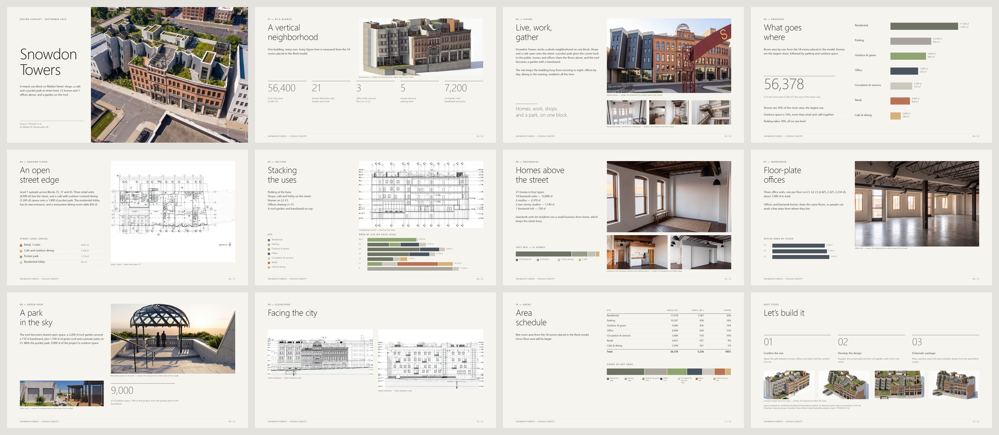

# Revit to InDesign

Source: [archaiflow.com/research/revit-indesign-deck](https://archaiflow.com/research/revit-indesign-deck) (25 Sep 2026). Shown on Snowdon Towers with Claude, the Revit MCP, and the Adobe connector. Figures below are from that page.

One prompt reads the open model and builds a presentation in InDesign. Headings are real text frames, colours are swatches, and views are linked images, so the file stays editable. Counts come from rooms placed in the model.

Finish [setup.md](../setup.md) first. Revit Connector must answer with the open file name.

## 1. Connect Adobe

Adobe is a published connector. In Claude, open **+** under the message box → **Connectors**, find **Adobe**, and sign in. Switch on Revit and Adobe.

The Adobe connector works from outside InDesign. It cannot move frames in the InDesign already open on your machine. For that, add the InDesign MCP in the optional section below, then run the same prompt.

## 2. One prompt

Open the model in Revit. Paste this into a new Claude chat:

```text
Make an InDesign presentation from the project open in Revit.
Ask every question as buttons, and wait for my answer before
the next step.

1. Read the model and sum up the project in 5 lines.
2. Ask who it's for, what it's for, and how many pages, in one go.
3. Ask the format: 16:9 or A4. Put your pick first.
4. Ask how to set the look: follow a file I give you (PPTX or
   PDF), or find references online. Recommend one.
   If online, show 3 references with pictures and what you'd
   take from each, then ask which.
5. Show the page plan, then ask: build it, or change it.
6. Build it in a new InDesign document, using views from the
   model. Show me each page when done.

Only read Revit: never change or save the model, and ask it
one thing at a time.
```

Claude asks four times before it builds: audience and purpose, page size, look, then the page plan. Page size and look come with a recommendation first. A PPTX or PDF of your own deck is the look that needs the fewest rounds, because Claude follows that grid, type, and colours.

Send Revit one question at a time. Two requests together can come back mixed.

## 3. What comes back

An ordinary InDesign file. Twelve pages at 16:9 on the Snowdon example:



When the model changes, run the prompt again. Last edits stay in InDesign, by hand.

## 4. Optional: InDesign MCP

Use this when you want to watch pages appear in the InDesign on your computer. Server: [studio-prisma/indesign-mcp-server](https://github.com/studio-prisma/indesign-mcp-server).

1. Install the LTS from [nodejs.org](https://nodejs.org/). Nothing is added inside InDesign by you.
2. Open InDesign, then paste this into Claude Code or Cursor:

```text
Connect the InDesign MCP server to Claude Desktop, using
https://github.com/studio-prisma/indesign-mcp-server

1. Put it in a folder in my home directory and install it.
2. Make a folder called "InDesign Work" in Documents, and let
   the server save files there only.
3. Add an "InDesign" entry to the mcpServers block of my
   claude_desktop_config.json. The repo README has the shape.
4. Check that it can reach InDesign without opening or
   changing any document.
5. Tell me when it's done, and remind me to quit Claude Desktop
   completely and reopen it.
```

After the restart, switch on InDesign next to Revit Connector. To use it from Cursor, add the same entry to `%USERPROFILE%\.cursor\mcp.json` and restart Cursor.
