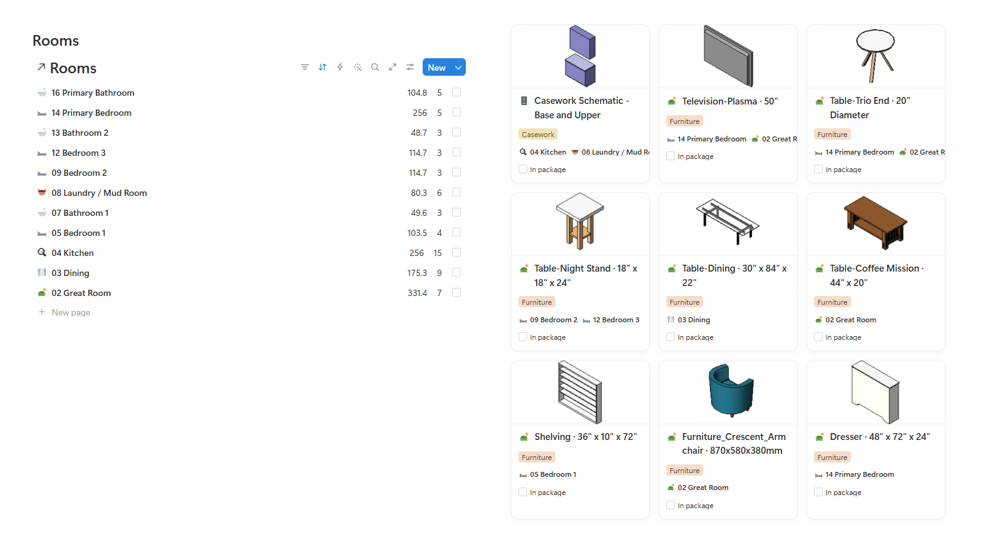
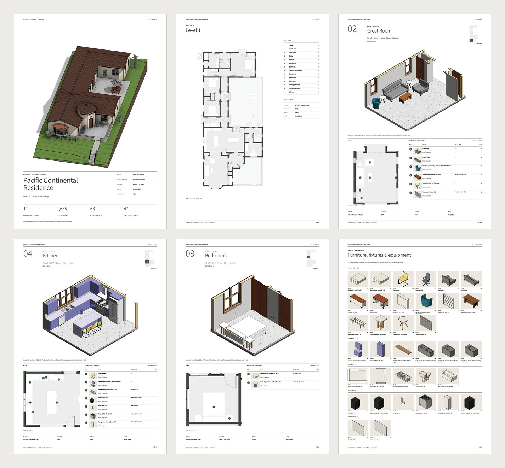

# Revit to Notion to InDesign

Source: [archaiflow.com/research/revit-notion-indesign](https://archaiflow.com/research/revit-notion-indesign) (4 Oct 2026). Shown on the Pacific Continental Residence in Revit 2027. Figures below are from that page.

Claude lists the furnished rooms, saves a picture of each element type, writes that list into Notion, then builds an InDesign booklet from the Notion cards.

Finish [setup.md](../setup.md) and the InDesign MCP in [revit-to-indesign/guide.md](../revit-to-indesign/guide.md). This one builds inside the open InDesign, so the Adobe cloud connector is not enough on its own.

## 1. Connect Notion

In Claude, open **+ → Connectors**, find **Notion**, and sign in. Switch on Revit, Notion, and InDesign. Open the model in Revit and open InDesign.

## 2. One prompt

```text
Use the Revit model I have open, Notion and InDesign.

1. List the rooms in the model that have furniture in them.
2. Save a picture of each element type in those rooms to a
   folder in Documents. Use these same files for Notion and
   InDesign.
3. In Notion, make two databases on a new page: Rooms and
   Elements. Add a row for each room, and a card for each
   element type with its picture, the rooms it is in, and an
   "In booklet" checkbox.
4. Suggest a few layouts for a booklet and ask me which one.
5. Build the booklet in a new InDesign document from what is
   in Notion: a cover, the floor plan, a page for each room
   with its plan, a 3D view and its elements, then all the
   elements at the end.
6. Tick "In booklet" on each card once it is on a page.

Ask before you add any views to the model, and never save it.
```

Claude stops once, at the layout. After you pick, the rest runs. On the published run that was 11 rooms and 47 element cards, then a 14-page A3 booklet.

## 3. What comes back

Notion holds a row per room and a card per element type. Each card has the Revit picture, the rooms that use it, and an “In booklet” checkbox that gets ticked when the page exists.



InDesign is a booklet built from those cards: cover, floor plan, one page per room (plan, 3D, elements), then the element library.



## 4. Why the list sits in the middle

Furniture in Revit is spread across families, types, and views. The Notion page is one list with a picture of each type and where it is used. The next question about that furniture can start from Notion, including when Revit is closed. The booklet is the first document built from the list.

When the model changes, run the prompt again. Notion stays the list the team checks. InDesign stays the booklet you hand over.
