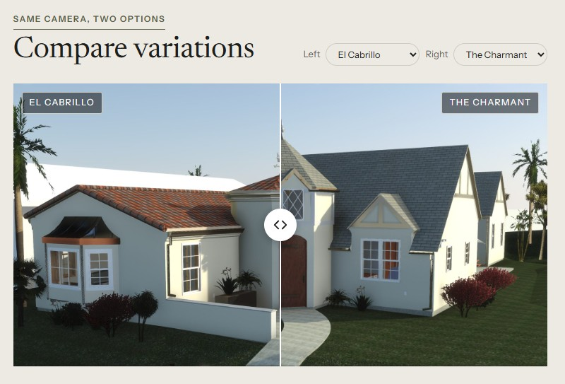
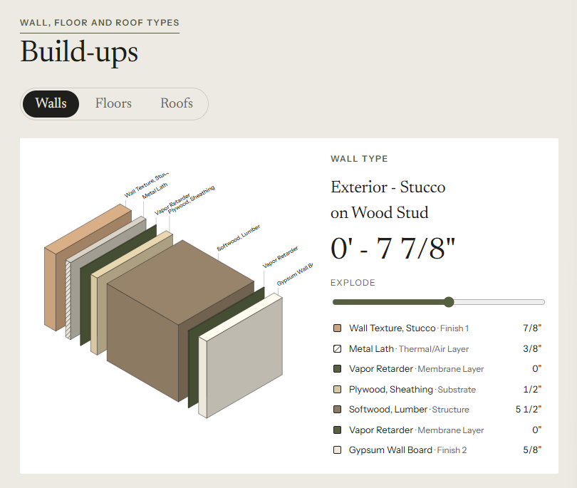
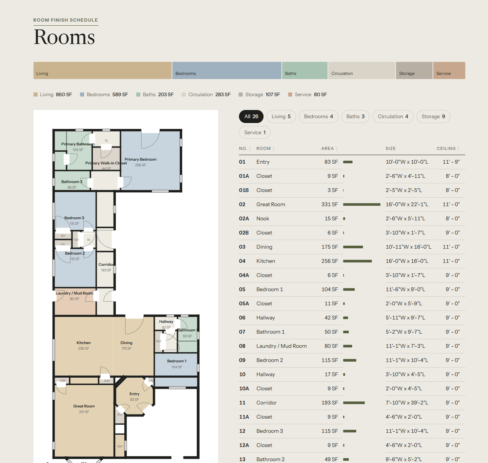

# Revit to Website

Source: [archaiflow.com/research/revit-website](https://archaiflow.com/research/revit-website) (14 Oct 2026). Shown on the Pacific Continental Residence in Revit 2027. Figures below are from that page.

Claude reads the open model and builds one project page: rooms, areas, wall build-ups, and the views it exports. You send the page as a link. Numbers on the page are numbers from the model. Anything the model does not have stays off the page, including placeholder lines such as “Enter address here”.

Finish [setup.md](../setup.md) first. This article uses the Revit connector only. It does not call Higgsfield. Renders on the example were made earlier from the same cameras. The prompt itself uses PNGs exported from Revit.

The dusk sales site, with the section cut and the floor hotspots, is [Revit to Home Tour](../revit-to-home-tour/guide.md). Use this folder when you want the project page described here.

## 1. One prompt

Open the model in Revit. Paste this into a new Claude chat:

```text
Use the Revit model I have open.

1. Read the project: Project Information, the levels and their
   heights, the rooms on each level with their areas, and the
   wall, floor and roof types with their layers.
2. Find the 3D and camera views worth showing. Open each one
   and tile them so I can watch, then export each as a PNG to
   a folder in Documents. If there is no exterior perspective,
   make one and tell me.
3. Suggest a few ways the website could look: style, colours
   and which sections. Ask me which one.
4. Build the one I pick as a single web page, with those
   pictures and the numbers read from the model, never with
   generated images or made-up text. Leave out anything the
   model doesn't have, including placeholder text like
   "Enter address here".
5. Make it an artifact I can share with a link or download,
   then go through it with me and tell me what to check
   first: anything the model was missing.

Never save the Revit model. When I say I'm done, delete the
views you made.
```

Claude stops once, at the look. After you pick, it builds the page and then lists what the model was missing. Views it created for the pictures stay until you say you are done. Then it deletes them. The model is never saved.

## 2. What comes back

One page that reads on a phone. When the model has design options, each option is the same camera on one slider.



Each wall, floor, and roof type is drawn layer by layer, with the thickness of each layer.



Every room on the plan carries its name and area. Hover or tap a room to find that row in the table.



## 3. Send it

Share the artifact from its Share menu, or download it. Anyone with the link can open it. Check with the client before you send a page that shows an address or a house that is not built yet.

To turn the download into the React app in this repo, put the HTML, the PNGs, and a `building.json` of the same rooms into `revit-to-website/site-source/` and ask Cursor to build a Vite page from those files only. Keep the rule from the prompt: no number that is not in the JSON.
